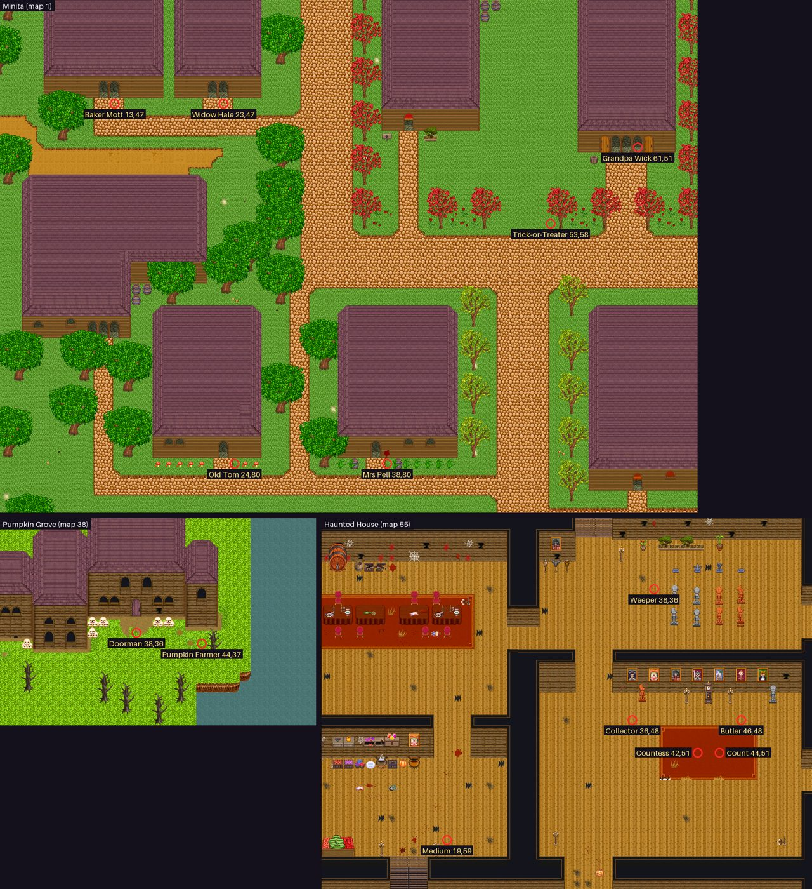

# Halloween Event Part 4 (Data) Implementation Plan

**Goal:** Put the Halloween event's content into the game data: the house map row and warps, items,
spell effects, NPC templates, drops, ~280 spawn rows, 22 quests, the candy community goal, and the
real ids, rooms and text in `halloween.json`. Plus one small code task the data exposed (Task 0).

**Architecture:** One generator, `tools/halloween-data/build.py`, holds the event's rows as Python
data, reads the next free id of every sheet live (`gsheets.py nextid`), resolves symbolic references
(`"@item:candy"`, `"@npc:weeper"`) to real ids, validates every spawn tile against the shipped map
files, and writes:
- `tools/halloween-data/out/batch.json` for `gsheets.py batch` (creates and updates, in dependency order),
- `tools/halloween-data/out/manual.md` for edits `gsheets.py` can't do (deleting warp rows),
- `Goose/Data/Illutia/Scripts/Global/Halloween/halloween.json` with the real ids filled in,
- `tools/halloween-data/out/revert.json`, the `update` batch that puts the four Grove templates back after the event.

The sheet is only written by `gsheets.py batch out/batch.json`, after a `--dry-run`, and only by
someone allowed to write it (standing rule for agents: read only). Re-running the generator before
apply is safe: it reallocates ids from the live `nextid`.

**Tech stack:** Python 3 (stdlib only), `.agents/skills/goose-game-data/scripts/gsheets.py`, the
`readmap.load` map reader (inline in the generator: 12-byte header `<hhii`, then per tile an `<i`
flag and five `<ih` layers; flag bit 2 = blocked).

Design: artifact "Haunted House Event" (https://claude.ai/artifact/PnXDddVa1NG5nFqmjL48vK).
Depends on Parts 1-3 for behaviour, not for the data itself: rows referencing scripts that do not
exist yet load fine; the script is only compiled when used (`/reloadsql` compiles referenced
scripts, so apply the batch after the scripts are merged).

---

## Findings that change earlier plans

1. **Map id 48 is not the house.** `Maps` row 48 is "The Ancients Dungeon 4" (`Map10024.map`). The
   house file `Map10048.map` has no row. Task 2 adds one with the next free id (currently **55**).
   The Part 2 test kit's "house map 48" is a fixture id and can stay.
2. **Tier rewards can't come from a bracket.** Brackets are *personal* rewards each player claims
   (`CommunityGoalHandler.cs:751-811`), and a goal's `communityRewards` fire once, on run
   completion (`:887-904`). One goal therefore can't unlock three tiers at 6k/20k/45k. Part 2 wired
   `CommunityGoal/HalloweenXpBonus.csx` as a reward script; Task 0 replaces that with a goal script
   that sets the tier flags as the running total crosses each threshold.
3. **A goal host never shows quests.** `PlayerLeftClickEvent.cs:54-62` opens the goal window and
   returns before quests, so the candy goal needs its own host NPC (the Butler, Task 5), not the
   Countess.
4. **"Talk to 5 townsfolk" needs quest NPCs.** `TalkedTo` only runs from `QuestWindow`
   (`QuestWindow.cs:40`), so each destination must be a Quest NPC listing quest 2 (precedent: quest
   88 is listed on both giver 250 and destination 251). Existing townsfolk are vendors or have quest
   lists where an earlier `return` (class, level, prerequisite) would hide quest 2. Task 5 adds five
   new Minita neighbours that list only quest 2.
5. **Warp deletions are manual.** `Warptiles` has no primary key and `gsheets.py` has no delete.
   `manual.md` lists the exact rows.
6. **The old upper floor (left half of map 39) becomes unreachable** once the Grove door and the
   internal stairs warps go. Its exit warps (rows 319-321, 39→38) stay so anyone who logged out
   there can walk out.
7. **Grove pumpkins are levelling mobs** (Pumpkin 20, Fail 25, Chief 30, Boss 35; 346 spawn rows).
   Raising them to 50 for the event is four template `update`s; `revert.json` restores them.
8. **Regen ticks every 2 s** (`RegenSpeed` 2, `Player.cs:1575`), so Pumpkin Pie / Witch's Brew are
   `hp_percent_regen` / `mp_percent_regen` 0.05 for 10 s: five ticks, 25% total.

## Decisions to confirm (defaults used below)

| # | Question | Default in this plan |
|---|---|---|
| D1 | Event end for the goal's `closesAt` (leaderboard closes then) | `2026-11-08T00:00:00` |
| D2 | Minimum level for the house | `min_level` 40 on the house map row (as map 39), and quest 4 (Doorman) min level 40 |
| D3 | Dyed Pumpkin Helm tint | `120,60,160,160` (purple) |
| D4 | Candy host name | "The Butler", Foyer (46,48) |
| D5 | Rename map 39 | "Haunted Basement" |

---

## APIs and data facts verified

| Fact | Where |
|---|---|
| Sheet columns, enums, required, defaults | `tools/DataEditor/schema.js`, `gsheets.py schema SHEET` |
| `batch` op shape `{"op": "create"/"update", "sheet", "id"?, "set": {...}}`, applied in order | `.agents/skills/goose-game-data/SKILL.md` "Creating several rows at once" |
| NPC `equipped_items` = 6 pairs in order Chest, Head, Legs, Feet, Shield, Weapon; `graphic,*` or `graphic,r,g,b,a` | `Goose/Inventory.cs:773-803`, sent raw in `Packets.cs:201` |
| `stationary` is inverted at load (`1` = can't move) | `Goose/NPCHandler.cs:98` |
| Spawn `properties` only supports `{"canMove": true/false}` (JSON bool) | SKILL.md "NPC Spawns" |
| Item `spell_effect_id` on gear = permanent buff while equipped; one effect per item | e.g. Doom Robe 394 → 161 |
| Existing single-stat effects: 66 MP static 100, 68 HP static 100, 70 SD .05, 71 SD .10, 76 SC .05, 79 melee crit .10, 80 MP% .01, 81 HP% .01, 175 DR .03 | `Spell Effects` sheet |
| Illusion precedent: spell 29 → effect 30 (`SelfPlayer`, Buff, 300 s, `body_id`), scroll item 59 (`Scroll`, `learn_spell_id`) | `Spells`, `Spell Effects`, `Items` |
| Snare precedent: effect 316 (`Snare`, `snare_percent` 40, 5 s); on-attack precedent 294 (`OnAttack`, `on_attack_spell_effect_id`, chance) | `Spell Effects` |
| Weapon pose is item `body_state` (4 one-hand, 5 staff, 6 two-hand) | Items 206, 618, 505 |
| Quest `Script` requirement/reward rows need `script path` or the load throws | SKILL.md "Quest Reqs" |
| Goal `properties`: `requirements[{key,type:"Item",item}]` (no target = open-ended), `brackets[{rank}|{minScore}]`, `closesAt`; target-less + `closesAt` completes at close | `CommunityGoalDefinitionParser.cs`, `CommunityGoalHandler.cs:447-478` |
| Goal script hooks `OnContributed(goal, run, player, key, amount, world)`, `GetSummaryText`; totals in `run.Totals[key]` | `Goose/Scripting/BaseCommunityGoalScript.cs:19,32`, `CommunityGoalRun.cs:19` |
| Next free ids now: Items 745, NPCs 262, Quests 90, Quest Reqs 103, Quest Rewards 173, Spells 162, Spell Effects 319, Maps 55, Community Goals 2 | `gsheets.py nextid` (re-read at build time) |

Map tiles verified on the shipped maps (`halloween-event` at 21d77ad):
- House (`Map10048`): stairs down x 14-17, y 61-65, blocked at y 66; every NPC stand tile below is free.
- Basement (`Map10039`): old arrival (93-95, 99) and exit (93-95, 100) free; pentagram as in Part 2.
- Minita (`Map10001`): (13,47), (23,47), (24,80), (38,80), (61,51), (53,58) free.

---

## Task 0 (code): Candy goal script sets the tiers

**Files:**
- Create: `Goose/Data/Illutia/Scripts/CommunityGoal/HalloweenCandyGoal.csx`
- Modify: `Global/Halloween/halloween.json` + `HalloweenConfig.csx` (`"goal": { "tiers": [6000, 20000, 45000] }`)
- Delete: `CommunityGoal/HalloweenXpBonus.csx` (moves into the goal script); update the Part 2 controller test that used it
- Test: `Goose.Tests/Halloween/HalloweenCandyGoalTests.cs`

**Behaviour** (`HalloweenCandyGoal : BaseCommunityGoalScript`, `#load`s config + common):
- `OnContributed` → `base.OnContributed(...)`, then `CheckTiers(world, run.Totals.GetValueOrDefault("candy"))`.
- `CheckTiers(world, total)`: for each `i` where `total >= tiers[i]` and `!Halloween.Tier(world, i+1)`:
  `SetTier(i+1, true)`, server-wide announcement (`"[Event] Tier N reached! …"` naming the unlock);
  for tier 1 also `Halloween.ApplyXpBonus(world)`. Flags make it idempotent, so a GM-set tier is
  not re-announced and a restart re-applies nothing (the controller's startup re-apply covers XP).
- `GetSummaryText` → base text plus "Next unlock: tier N at X candy" (or "All tiers unlocked").

**Mutation impact:** source of truth is the world flags `halloween.tier1..3`
(`CommunityGoalHandler.SetFlag`, persisted with the goal save); readers are `Halloween.Tier`
(basement gate, invasion, Groundskeeper drop table) and the controller's startup XP re-apply. No
derived state besides `world.ExperienceModifier`, set by `ApplyXpBonus`.

**Tests:**
- `Crossing_6000_sets_tier1_and_applies_xp_bonus`.
- `Single_donation_crossing_two_thresholds_sets_both` (adversarial: loop, not `else if`).
- `Already_set_tier_is_not_reannounced` (set flag first; no `SendToAll` captured).
- `Summary_names_next_tier`.

**Commit:** `feat(halloween): candy goal script unlocks tiers`

---

## Task 1: Generator skeleton, id allocation and validation

**Files:** Create `tools/halloween-data/build.py`, `tools/halloween-data/README.md` (how to run and apply), `tools/halloween-data/.gitignore` (`out/`).

- `python3 tools/halloween-data/build.py [--offline ids.json]` runs from the repo root.
- Ids: for each sheet call `gsheets.py nextid SHEET` once and allocate sequentially in definition
  order. `--offline` takes a JSON of next ids (for tests/review without network).
- References: any string value `"@kind:key"` is replaced by the allocated id (`kind` ∈ item, npc,
  effect, spell, quest, map). An unknown key fails the build.
- **Validation (fail the build):** every spawn and NPC tile is in bounds and free on its map file;
  no two spawns share a tile; every `Enum` value is a member listed by `gsheets.py schema`; Quest/NPC
  text lines ≤ 50 chars after splitting on `\n`; every quest giver's `quest ids` order puts
  prerequisite-free quests first; every `Script` row has a script path that exists under
  `Goose/Data/Illutia/`.
- Output order in `batch.json`: Spell Effects, Spells, Items, NPCs (creates + 4 updates), NPC Drops,
  NPC Spawns, Maps, Warptiles (creates/updates), Quests, Quest Reqs, Quest Rewards, Community Goals.

**Test:** `python3 tools/halloween-data/build.py --offline tools/halloween-data/test_ids.json`
produces the four outputs, and a deliberately blocked spawn tile (temporary edit) fails with its
coordinates. Commit: `feat(tools): halloween data generator skeleton`.

---

## Task 2: Maps and warps

**Maps:**
- Create: `Haunted House`, `Map10048.map`, `min_level` 40 (D2), `script_path` `Scripts/Map/HauntedHouse.csx`.
- Update 39: `map_name` "Haunted Basement" (D5), `script_path` `Scripts/Map/HauntedBasement.csx`.
- Map 38 unchanged.

**Warptiles** (columns: map, x, y, to map, to x, to y):
- Create house → basement: `(H,14,65)→(39,93,99)`, `(H,15,65)→(39,94,99)`, `(H,16,65)→(39,94,99)`, `(H,17,65)→(39,95,99)`.
- Change rows 325-327 (basement exit `39:(93..95,100)`) to go to the house top of the stairs:
  `→(H,15,60)`, `(H,16,60)`, `(H,17,60)` (manual: no pk to update by).
- Delete rows 316-318 (`38:(37..39,35)→39`, the Grove door; the Doorman replaces it) and 322-324
  (`39:(40..42,4)→39`, old upper floor → basement). Keep 319-321 (finding 6).

All of these warp changes go into `manual.md` with the row numbers re-read at build time
(`gsheets.py read Warptiles --where "map id=38"` / `39`), matched on all six values so a shifted row
number can't hit the wrong warp.

**halloween.json:** `maps.house` = new id, `basement` 39, `grove` 38, `basementArrival` [94, 98].

---

## Task 3: Spell effects and the illusion spell

All `spell_effected` `Self` and `effect_type` `Buff` with blank duration (permanent while equipped)
unless stated. `works_not_in_pvp` 1, `buff_graphic` 810035 / file 20107 as the existing item effects.

| key | name | values |
|---|---|---|
| sword | Pumpkin Sword | spell_damage .10, spell_crit .05 |
| boots | Rootstompers | spell_damage .05, spell_crit .02 |
| grit | Groundskeeper's Grit (Chaps, Hockey Mask) | damage_reduce .04, spell_damage .01 |
| chainsaw | Bloody Chainsaw | melee_crit .10, hp_static_regen 100 |
| staff | Pumpkin Staff | spell_damage .05, mp_static_regen 100 |
| helmTop | Pumpkin Helm | spell_damage .10, hp_percent_regen .01, mp_percent_regen .01 |
| witch | Witch Mask | damage_reduce .03, spell_damage .01, spell_crit .01 |
| pie | Pumpkin Pie | duration 10, hp_percent_regen .05, buff_graphic 810008, oneffect "You feel warm and full." |
| brew | Witch's Brew | duration 10, mp_percent_regen .05, buff_graphic 810032, oneffect "Your mind fizzes." |
| illusion | Illusion: Pumpkin | copy effect 30: `SelfPlayer`, duration 300, body_id 127, spell_animation 815014, buff_graphic 810007 |
| weeperCap | Weeper's Cap | `Buff`, `script_path` `Scripts/Spell/HalloweenDamageCap.csx`, buff_removable 0 |
| gkCurve | Groundskeeper's Curve | `Buff`, `script_path` `Scripts/Spell/HalloweenDamageCurve.csx`, buff_removable 0 |
| ghostSnare | Ghostly Chill | `spell_effected` `Player`, `Snare`, duration 4, snare_percent 50, buff_graphic 810023 |
| ghostSnareOnHit | Ghostly Touch | `OnAttack`, `on_attack_spell_effect_id` @effect:ghostSnare, chance 100 |

Reused, not created: 70 (Shield, Party Costume, Goblin), 71 (dyed Pumpkin Helm), 76 (Clown), 80
(Mummy), 81 (Zombie).

**Spells:** create `Illusion: Pumpkin` copying spell 29 (`spell_target` Self, aether 60000,
mp_static_cost 100, spellbook graphic 810007/20107), `spell_effect_id` @effect:illusion.

**halloween.json:** `effects.weeperCap`, `effects.groundskeeperCurve`, `effects.ghostSnareOnHit`.

---

## Task 4: Items

Common: `min_level` 50 on gear unless stated; `lore` 1 and `bindonpickup` 1 where "bound";
`event` 1 on everything. Icons from the design's icon table. Stats columns: `player_hp`, `player_mp`,
`stat_ac`, `stat_str/sta/dex/int` ("stats" = all four).

| key | name | usetype / slot / type | values |
|---|---|---|---|
| candy | Candy | NoUse, stack 10000, bop | icon 2281·332500 (wrapped candy), value 0, desc "Sweet, sticky and strangely warm." |
| costume | Party Costume | Armor / Helmet / Cloth, bound | hp 2000 mp 2000 ac 150 stats 10, effect 70, equip 11, icon 2281·332509, `properties` `{"hideOtherSlots": true}`, `script_path` `Scripts/Item/HalloweenCostume.csx`, `script_params` looks (below) |
| goblin / zombie / mummy | Goblin / Zombie / Mummy Mask | Armor / Helmet / Cloth | hp 1000 mp 1000 ac 100; effects 70 / 81 / 80; equip 72 / 115 / 159; icon 2278·332240; script `HalloweenCostume.csx`, no params |
| clown | Mad Clown Mask | as masks, bound | effect 76, equip 112 |
| witch | Witch Mask | as masks, bound | effect @witch, equip 114 |
| sword | Pumpkin Sword | Weapon / OneHanded / OneHandedSword, bound | dmg 175, hp 1500 mp 1500 stats 15, effect @sword, equip 33, body_state 4, icon 2281·332511 |
| boots | Rootstompers | Armor / Shoes / Leather, bound | hp 1750 mp 1750 ac 125 stats 15, effect @boots, equip 13, icon 2278·332213 |
| shield | Jack-o'-Lantern Shield | Armor / Shield / Plate, bound | hp 1500 mp 1500 ac 175 stats 10, effect 70, equip 63, icon 2281·332502 |
| chaps | Chainsaw Chaps | Armor / Pants / Leather, bound | hp 2000 mp 2000 ac 150 stats 15, effect @grit, equip 31, tint 200,70,60,140, icon 2278·332204 |
| hockey | Hockey Mask | Armor / Helmet / Plate, bound | hp 2000 mp 1000 ac 150 str 25 sta 25, effect @grit, equip 37, icon 2278·332240 |
| chainsaw | Bloody Chainsaw | Weapon / TwoHanded / TwoHandedSword, min_level 25 | dmg 180, hp 500 mp 100 ac 50 stats 20, effect @chainsaw, equip 256, body_state 6, icon 20397·820015 |
| staff | Pumpkin Staff | Weapon / OneHanded / OneHandedBlunt, min_level 25 | dmg 100, hp 100 mp 500 stats 20, effect @staff, equip 35, body_state 5, icon 2281·332508 |
| robe | Collector's Robe | Armor / Chest / Cloth, bound, lore | hp 3000 mp 3000 ac 200 stats 15, equip 34, icon 2278·332201 |
| helmTop | Pumpkin Helm | Armor / Helmet / Plate, bound | hp 2500 mp 2500 ac 175 stats 20, effect @helmTop, equip 28, icon 2281·332506 |
| helmDyed | Pumpkin Helm (dyed) — name "Pumpkin Helm" | as above | hp 1500 mp 1500 ac 150 stats 10, effect 71, tint D3 |
| pie | Pumpkin Pie | OneTime, stack 100 | effect @pie, icon 2272·331646, value 200 |
| brew | Witch's Brew | OneTime, stack 100 | effect @brew, icon 2272·331609, value 200 |
| candle | Ritual Candle | NoUse, stack 20, **not bound** | icon 20408·821125, desc "Black wax, half-melted. It burns brightest where the floor is marked." |
| ecto | Ectoplasm | NoUse, stack 100 | icon 2271·331509, tint 86,179,11,200 |
| scroll | Scroll: Pumpkin Illusion | Scroll | learn_spell_id @spell:illusion, icon 20398·820110, value 200 |
| claw | Weeper's Claw | NoUse | icon 2269·331370 |
| shroud | Phantom Shroud | NoUse | icon 20399·820224 |
| heart | Harvest Heart | NoUse | icon 2281·332507 |

Every item gets a one-line description (≤ 50 chars per line). Quest items have value 0.

**Party Costume looks** (`script_params`, read by `HalloweenCostume.OnCreateEvent`):
`[{"graphic":11,"r":0,"g":0,"b":0,"a":0},{"graphic":17,…},{"graphic":19,…},{"graphic":26,…},{"graphic":90,…},{"graphic":143,…}]`.

**halloween.json:** `items.candy`, `partyCostume`, `masks` [goblin, zombie, mummy, clown, witch], `ritualCandle`.

---

## Task 5: NPC templates

Common for monsters: `type` Monster, level 50, `class id` 3, `respawn time` 30, `attack range` 1,
`attack speed` 1, `stunnable` 1, `slowable` 1, `see invisible` 1, `aggro range` 3. "Moves" means
`stationary` blank; stationary guests get `stationary` 1. Human guests: `body id` 1, `body state` 4,
`hair id` 0. Stats come from the design's tier table (HP / hit (`weapon dmg`) / move / XP).

| key | name | look | HP / hit / move / XP | notes |
|---|---|---|---|---|
| penguin | Penguin Guest | face 1, equip `0,*,11,*,0,*,0,*,0,*,0,*` | 17k / 1400 / 1.0 / 2400 | stationary |
| frog | Frog Guest | face 16, helm 17 | Rabid | stationary |
| bunny | Bunny Guest | face 5, helm 90 | Rabid | stationary |
| purple | Purple Ghost Guest | face 2, helm 143 | Rabid | stationary |
| ghostGuest | Ghost Guest | face 4, helm 19 | 47k / 2300 / 1.0 / 3000 | stationary |
| devil | Devil Guest | face 13, helm 26 | 79k / 3500 / 1.0 / 4400 | moves |

Ballroom guests use the same five templates with spawn `properties` `{"canMove": true}`, so there
are no roaming copies and every guest kill counts for quests 5 and 12.
| setting | Possessed Place Setting | body 307 | 10k / 1200 / 0.8 / 1700 | stationary |
| cook | Ghoul Cook | body 169 | 47k / 2800 / 1.5 / 3000 | moves |
| wailing | Wailing Ghost | body 220 | 47k / 3000 / 1.0 / 3000 | `respawn time` 0 (ambush only) |
| flickering | Flickering Ghost | body 306 | 10k / 1800 / 0.8 / 1700 | ambush only |
| phantom | Pink Phantom | body 308 | 150k / 10k / 1.0 / 6000 | ambush only |
| bloody | Bloody Ghost | body 305 | 79k / 10k / 1.0 / 4400 | ambush only |
| bloodyAdd | Bloody Ghost | body 305 | as bloody | Groundskeeper add, no drops |
| bones | Restless Bones | body 10106 | 47k / 2300 / 1.0 / 3000 | ambush only |
| weeper | The Weeper | body 231 | 12M / 0 / 1.2 / 100000 | respawn 1500, aggro 6, attack speed 2, `script_path` `Scripts/NPC/Weeper.csx`, `stunnable`/`slowable` 0 |
| stalker | The Groundskeeper | same look as `gk` | 1 / 0 / 0.34 / 0 | `invincible` 1, aggro 0, attack speed 0, `Scripts/NPC/Stalker.csx` |
| gk | The Groundskeeper | human, helm 37 (hockey), weapon 256, chest 34 tint 80,70,60,200 | 8M / 0 / 1.0 / 7500 | aggro 12, attack speed 2.5, `Scripts/NPC/Groundskeeper.csx`, stun/slow 0 |
| countess | The Countess | body 154 | — | `type` Quest, invincible, stationary, quests 5-11 |
| count | The Count | body 155 | — | Quest, quests 12 13 |
| medium | The Medium | body 220, body tint 150,200,255,180 | — | Quest, quests 18 19 20 |
| kid | Trick-or-Treater | body 130 | — | Quest, quests 1 2 3 |
| doorman | The Doorman | human, helm 35, face 5, hair 0 | — | Quest, quest 4 |
| collector | The Collector | human, chest 34, helm 114, hair 23 | — | Quest, quests 14 15 16 17 |
| farmer | Pumpkin Farmer | copy Farmer Pete 186 (chest 12, hair 31, face 1) | — | Quest, quests 21 22 |
| butler | The Butler | human, chest 34 tint 20,20,20,200, face 1, hair 2 | — | Quest, no quests (goal host, D4) |
| neighbour1-5 | Minita Neighbour (titles: Baker, Widow Hale, Old Tom, the Twins, Mrs Pell) | copy existing townsfolk looks | — | Quest, quest 2 only |

Quest/friendly NPCs copy Farmer Pete's combat columns (`invincible` 1, `stationary` 1, level 50).
Wailing and Flickering get `script params` none; their snare comes from `ghostSnareOnHit` only when
the Groundskeeper adds them (Part 3).

**Updates (event values; originals into `revert.json`):**
- 166 Pumpkin: level 50, hp 3200, weapon dmg 1200, exp 1250.
- 168 Chief Pumpkin: level 50, hp 3200, weapon dmg 1200, exp 1250.
- 169 Boss Pumpkin → name "The Pumpkin King", level 50, hp 1,000,000, weapon dmg 20000, exp 7500, body 127, body tint 255,140,0,160.
- 167 Fail Pumpkin → name "Jack O'Malice", level 50, hp 700,000, weapon dmg 12000, exp 5000.

**halloween.json:** `npcs.*` (stalker, groundskeeper, wailingGhost, flickeringGhost, pinkPhantom,
bloodyGhost, restlessBones); `groundskeeper.adds` = `[[setting,8]]`, `[[wailing,4],[flickering,2]]`,
`[[bloodyAdd,2]]`; `candy.byTemplate`: every guest, setting, cook, pumpkins 166-169 → [1,3]; weeper
→ [15,25]; phantom → [15,25]; gk → [50,80].

---

## Task 6: NPC drops

| NPC | item | stack | rate |
|---|---|---|---|
| each of the 6 guest templates | goblin, zombie, mummy | 1 | 1 each |
| each guest | brew | 1 | 1 |
| cook | pie | 1 | 2 |
| wailing, flickering | ecto | 1 | 25 |
| phantom | candle | 1 | 50 |
| phantom | shroud | 1 | 50 |
| weeper | claw | 1 | 100 |
| weeper | candle | 1-2 (`max stack` 2) | 100 |
| gk | chaps, hockey, chainsaw, staff | 1 | 10 each |
| 169 Pumpkin King | heart | 1-2 | 100 |
| 169 Pumpkin King | boots | 1 | 10 |
| 167 Jack O'Malice | shield | 1 | 10 |

Tier 3's 15% Groundskeeper rate is applied by the Groundskeeper script (Part 3), not by a drop row.
`revert.json` deletes nothing: the Grove boss drops are listed in `manual.md` for removal after the event.

---

## Task 7: Spawns

- **House guests:** from `tools/halloween-data/spawn_plan.json` (copy of the design's plan:
  150 stationary guests in clusters, 23 Place Settings around the dining table). Roaming, all with
  `{"canMove": true}`: Ballroom 48 guests (the five non-Devil types, as even as 48 allows) and
  10 Devils; Devils elsewhere: Library 5, Kids' Bedroom 3, Master Bedroom 3, Statue Gallery 2,
  Garden 4; 14 Ghoul Cooks in the Kitchen. Roaming tiles: the generator picks free tiles inside
  the room rect that are reachable on foot from the Foyer (flood fill), with a fixed seed
  (`random.Random(31)`), ≥ 2 tiles apart, outside the pond
  (x 62-75, y 70-81) and off the stairs (x 14-17, y 61-65).
- **Weeper:** one at (38,36).
- **Friendly:** Countess (H,42,51), Count (H,44,51), Collector (H,36,48), Medium (H,19,59),
  Butler (H,46,48), Doorman (38,38,36), Farmer (38,44,37), Trick-or-Treater (1,53,58),
  neighbours (1,13,47), (1,23,47), (1,24,80), (1,38,80), (1,61,51).
- Basement: none (ambush only).

Validation from Task 1 covers every tile. Expected count ≈ 280; the generator prints per-room counts.

**Where the friendly NPCs and the Weeper stand** (map: `2026-10-18-halloween-npc-locations.jpg`):



| NPC | Map | Tile | Spot | Look copied from |
|---|---|---|---|---|
| Trick-or-Treater | Minita (1) | 53, 58 | South edge of the central green, by the red trees | body 130 |
| Baker Mott | Minita (1) | 13, 47 | Doorstep of the first house in the north-west row | Potion Guy (100) |
| Widow Hale | Minita (1) | 23, 47 | Doorstep of the second house in that row | Cloth Armor Guy (106) |
| Old Tom | Minita (1) | 24, 80 | Doorstep of the south-west house | Silk Armor Guy (108) |
| Mrs Pell | Minita (1) | 38, 80 | Doorstep of the south-middle house | Tailoring Supplies (148) |
| Grandpa Wick | Minita (1) | 61, 51 | Doorstep of the east house on the central green | Aryn the Rogue Trainer (184) |
| The Doorman | Pumpkin Grove (38) | 38, 36 | In front of the house's door (the removed warp) | helm 35, face 5 |
| Pumpkin Farmer | Pumpkin Grove (38) | 44, 37 | Beside the east wing, among the pumpkins | Farmer Pete (186) |
| The Countess | House (55) | 42, 51 | Foyer, centre of the red carpet | body 154 |
| The Count | House (55) | 44, 51 | Foyer, beside her | body 155 |
| The Collector | House (55) | 36, 48 | Foyer, under the portraits, west of the carpet | chest 34, helm 114 |
| The Butler | House (55) | 46, 48 | Foyer, under the portraits, east of the carpet (candy goal) | chest 34 dyed black |
| The Medium | House (55) | 19, 59 | Kitchen, beside the basement stairs | body 220, pale blue |
| The Weeper | House (55) | 38, 36 | Statue Gallery, his patrol start | body 231 |

The neighbours stand one tile below their house's door, on the path. Map 55 is the id the house map
gets if the sheet's next map id is still 55 when the batch is built.

---

## Task 8: Quests, requirements, rewards

The design's quest table, in giver order. Text is written in the generator with real newlines and
wrapped at 50. `Script` requirement = `Scripts/Quest/HalloweenWearing.csx`,
params `{"items":[@item:costume, @item:goblin, @item:zombie, @item:mummy, @item:clown, @item:witch]}`
(a mask counts as a costume, as in the house). Kill quests use one `Kill` row per template, so
"10 of each guest" is six rows. `keep requirement?` is 0 everywhere except quest 19.

| # | min lvl | repeat | prereq | requirements | rewards |
|---|---|---|---|---|---|
| 1 Dress Up | 1 | | | Gold 5000 | Item costume |
| 2 Trick or Treat! | 1 | | 1 | TalkToNPC neighbour1-5 ×1; Script wearing | XP 10000, Gold 2000, Item candy 25, Item pie 3 |
| 3 The House on the Hill | 1 | | 2 | TalkToNPC doorman ×1 | XP 1000 |
| 4 Trick or Treat? | 40 (D2) | yes | | Script wearing | Script `Scripts/Quest/HalloweenDoorman.csx` |
| 5 Uninvited Guests | 50 | | | Kill ×10 each of 6 guests | XP 120k, Gold 25k, candy 50 |
| 6 Table Manners | 50 | | | Kill setting ×20 | XP 60k, Gold 15k, candy 20 |
| 7 Spirits in the Walls | 50 | | | Item ecto 5 | XP 40k, Gold 15k, candy 20 |
| 8 Something Pink | 50 | | | Kill phantom ×1 | XP 80k, Gold 20k, candy 30 |
| 9 The Weeper | 50 | | | Kill weeper ×1 | XP 150k, Gold 30k, candy 40 |
| 10 Harvest Heart | 50 | | | Kill 169 ×1 | XP 120k, Gold 30k, candy 40 |
| 11 Lights Out | 50 | | 5,6,7,8,9,10 | Kill gk ×1 | Item sword, XP 200k, Gold 50k |
| 12 Party Crashers | 50 | yes | | Kill ×5 each of 6 guests | XP 30k, Gold 8k, brew 3, candy 10 |
| 13 Fresh Pies | 50 | yes | | Kill cook ×20 | XP 20k, Gold 5k, pie 2, candy 15 |
| 14 Masquerade: Goblin | 50 | | | Item goblin 1 | Item witch, XP 25k, Gold 10k |
| 15 Masquerade: Mummy | 50 | | | Item mummy 1 | Item clown, XP 25k, Gold 10k |
| 16 Masquerade: Zombie | 50 | | | Item zombie 1 | Title "Masquerader", XP 25k, Gold 10k, candy 20 |
| 17 The Finishing Touch | 50 | | 14,15,16 | Item shroud 1, claw 1, heart 1 | Item robe, XP 50k, Gold 20k |
| 18 Ghost Story | 50 | | | Item ecto 3 | XP 40k, Gold 10k |
| 19 The Medium's Warning | 50 | | 18 | Item candle 5, keep 1 | XP 10k |
| 20 Every Midnight | 50 | | 19 | Kill gk ×10 | Title "Survivor", XP 300k, Gold 75k |
| 21 Pumpkin Patch | 50 | | | Kill 166 ×10, 168 ×10 | XP 70k, Gold 18k, candy 20 |
| 22 Pumpkin Slayer | 50 | | 21 | Kill 166 ×250, 168 ×250 | Title "Pumpkin Slayer", Item scroll |

Candy rewards are `Item` rewards of the candy template (they go into the bag like dropped candy).
**Giver `quest ids` order** (prerequisite-free first, chains in order):
kid `1 2 3`, doorman `4 3`, countess `5 6 7 8 9 10 11`, count `12 13`, collector `14 15 16 17`,
medium `18 19 20`, farmer `21 22`, each neighbour `2`.
Quest 4 has no prerequisite (the wearing check is the gate), so it comes before quest 3 on the
Doorman: quest 3 is listed there only as its TalkToNPC destination, and its unmet prerequisite would
otherwise end the list before quest 4. Quest 11's prerequisites block nothing because it is last.

---

## Task 9: Candy community goal

`Community Goals` row: name "The Candy Count", host @npc:butler, `script_path`
`Scripts/CommunityGoal/HalloweenCandyGoal.csx`, description about filling the house's candy bowl, properties:

```json
{
  "requirements": [ { "key": "candy", "type": "Item", "item": "@item:candy", "label": "Candy" } ],
  "closesAt": "2026-11-08T00:00:00",
  "brackets": [
    { "rank": 1, "rewards": [ { "type": "Item", "value": "@item:helmTop" }, { "type": "Title", "value": "Candy Baron" } ] },
    { "rank": 2, "rewards": [ { "type": "Item", "value": "@item:helmTop" }, { "type": "Title", "value": "Sugar Fiend" } ] },
    { "rank": 3, "rewards": [ { "type": "Item", "value": "@item:helmTop" }, { "type": "Title", "value": "Sweet Tooth" } ] },
    { "minScore": 100, "rewards": [ { "type": "Item", "value": "@item:helmDyed" }, { "type": "Title", "value": "Trick or Treater" } ] }
  ]
}
```

The generator substitutes the ids as JSON numbers. Check the result with
`CommunityGoalDefinitionParser.Parse` through an existing goal test helper before applying
(Task 10 step 2).

---

## Task 10: halloween.json, text, apply and verify

**halloween.json** (written by the generator, merged into the shipped file keeping every tunable):
- ids from Tasks 2-5.
- `rooms` (house tiles, inclusive; first match wins):
  Foyer [27,42,51,62] w0; Library [2,2,35,26] w2; Statue Gallery [27,27,51,41] w2;
  Kids' Bedroom [37,2,66,21] w1; Master Bedroom [68,2,94,21] w1 table `master`;
  Dining Room [2,29,25,47] w1; Kitchen [2,48,25,65] w0.5; Ballroom [52,28,100,61] w0.5;
  Garden [54,62,83,90] w0.5.
- `fakeScares`: 15 house lines, 10 basement lines, 4 directional, e.g. house: "The statue was
  facing the other way a moment ago.", "A music box starts, then stops.", "Someone laughs in the
  next room.", "The candles all lean towards you.", "Wet footprints lead under the door.",
  "The portrait's eyes follow you…", "A door slams upstairs.", "A cold hand brushes your neck.",
  "The clock chimes thirteen.", "Glass shatters somewhere below.", "A child whispers your name.",
  "The rug ripples as if something moved under it.", "A chair scrapes back from the table.",
  "Every light dims for a heartbeat.", "Someone hums along to the music, off-key.";
  basement: "Something drips in the dark.", "Chains rattle behind the wall.", "The bones shift.",
  "A chainsaw coughs once, far away.", "Your torch gutters.", "Scratching from inside the walls.",
  "The air smells of wet earth.", "A shovel scrapes stone.", "Something heavy is dragged across the floor.",
  "You hear breathing that isn't yours."; directional: "Footsteps behind you.", "Something moves to
  your left.", "A shape darts past on your right.", "Breath on the back of your neck."
- `invasion`: towns `[{"map": 1, "rect": [35,30,71,62]}]`, templates = the six stationary guest ids
  + wailing + flickering.
- Weeper `loops` stay as validated for greedy movement; thin them on the test server once A* is
  watched in play.

**Steps:**
1. `python3 tools/halloween-data/build.py` → review `out/batch.json`, `out/manual.md`, the
   `halloween.json` diff, the spawn counts.
2. `dotnet test Goose.Tests --filter FullyQualifiedName~Halloween` (config validation catches bad
   ids/rooms) and a one-off test that parses the generated goal properties.
3. `gsheets.py batch tools/halloween-data/out/batch.json --dry-run`, then without `--dry-run` (by an
   allowed writer), then the `manual.md` edits.
4. Read back: `gsheets.py read Items --id <first>` … spot-check one row per sheet; `nextid` moved by
   the expected counts.
5. Test server: `/updatesql`, `/reloadscripts`; `/halloween on`; walk the Kid → Doorman chain in a
   costume; check the Foyer NPCs, a guest cluster, `/halloween weeper`, basement stairs refusal
   before tier 2, `/halloween tier 2 1`, stairs work, donate candy to the Butler and watch tier 1 fire.
6. Commit generator + `halloween.json`: `feat(halloween): event data generator and config ids`.

## End of event

`/halloween off` (evicts and stops everything), then apply `out/revert.json` (Grove templates) and
the "after the event" section of `manual.md`: remove the two Grove boss drop rows, restore warp
rows 316-318 if the old Haunted House should come back, and remove `script_path` from the costume
and masks (items keep working without it).
